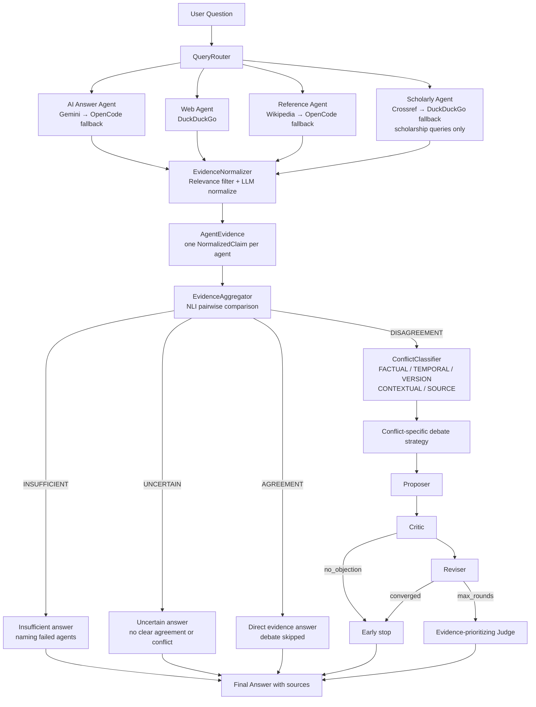
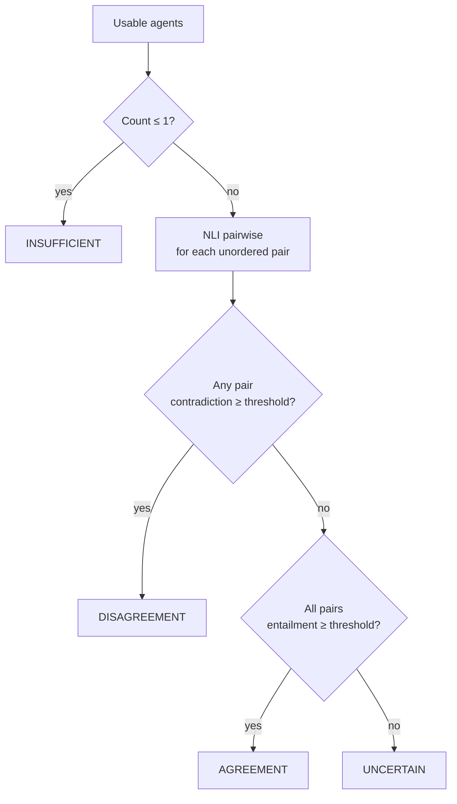
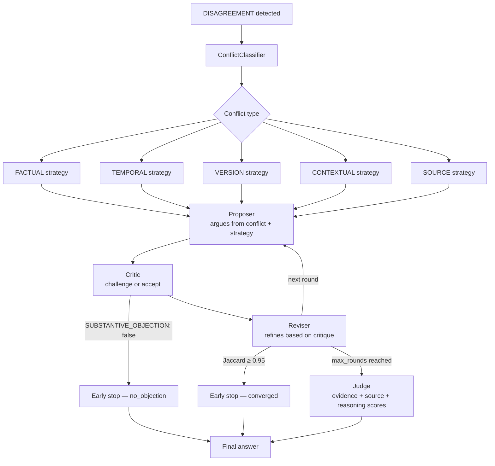
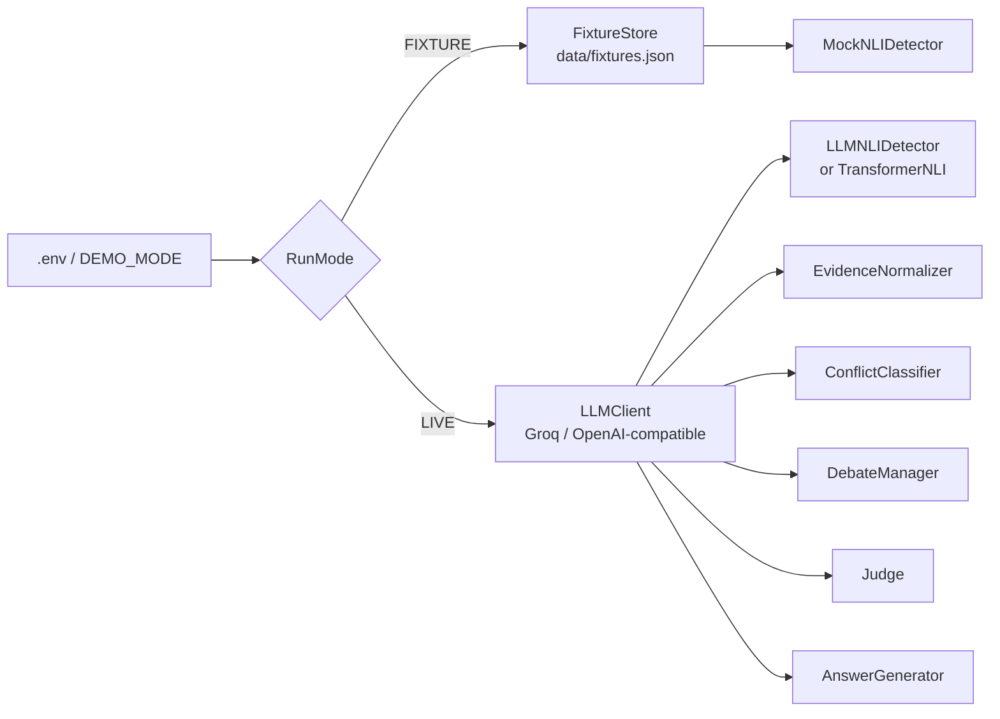
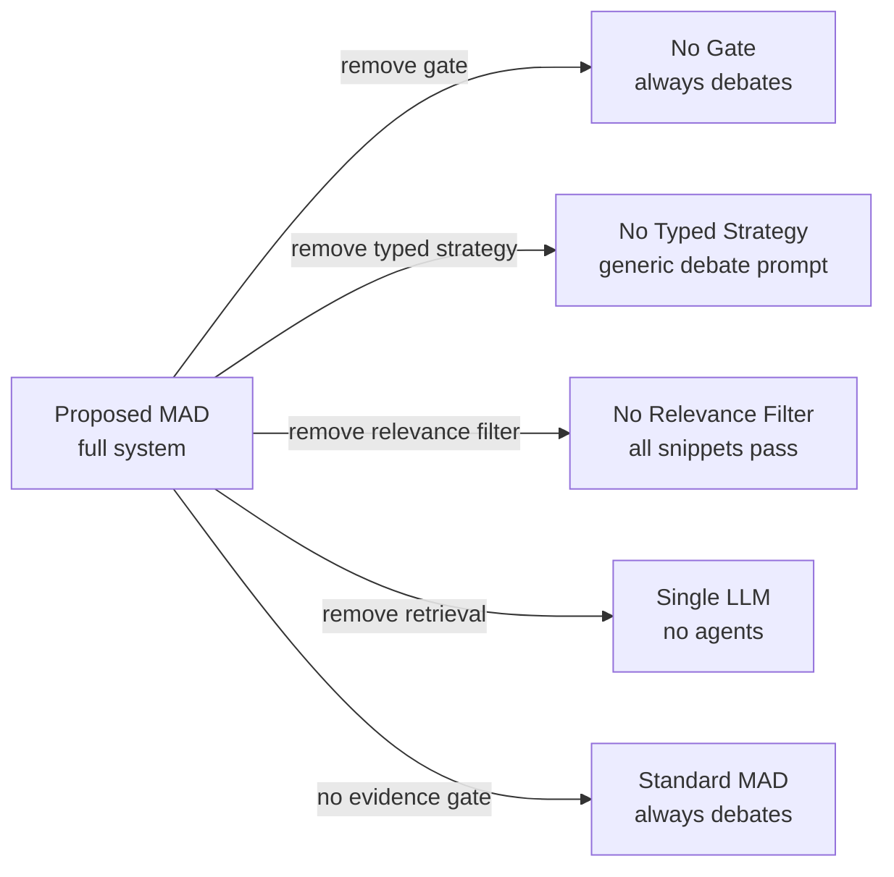

# Multi-Agent Debate Framework using Evidence Disagreement Triggering and Conflict-Type Classification

Evidence-MAD is a research prototype for **evidence-triggered, conflict-type-aware multi-agent debate**.
Three independent agents retrieve evidence in parallel, their claims are compared with
query-aware NLI, and debate fires when any pair materially disagrees. This includes
an agent rejecting a queried fact or entity as unsupported, unknown, unverifiable, or
nonexistent while another agent gives an affirmative answer.

```text
Question
  → parallel retrieval (Web + Reference + Scholarly agents)
  → relevance filter + LLM normalization → NormalizedClaim per agent
  → query-aware NLI pairwise comparison → EvidenceDecision
      AGREEMENT   → direct evidence answer, debate skipped
      UNCERTAIN   → "evidence neither agreed nor conflicted"
      INSUFFICIENT → explicit "not enough data" answer
      DISAGREEMENT → classify conflict type → Propose/Critique/Revise → Judge → answer
```

## 1. Requirements

- Python 3.10 or newer
- Internet access for live mode
- A Groq API key (or any OpenAI-compatible endpoint) for the LLM pipeline
- A Gemini API key for the AI Answer Agent (optional; OpenCode CLI fallback available)
- `opencode` CLI on `PATH` for the OpenCode fallback (optional)
- Hugging Face model download only when `NLI_MODE=transformers`

Offline fixture mode does not require any API keys.

## 2. Installation

```bash
python -m venv venv
source venv/bin/activate          # Windows: venv\Scripts\Activate.ps1
pip install --upgrade pip
pip install -r requirements.txt
cp .env.example .env              # Windows: copy .env.example .env
```

`.env` is git-ignored. Never commit API keys.

## 3. Configuration

Edit `.env`:

```dotenv
# LLM — Groq or any OpenAI-compatible endpoint
LLM_API_KEY=
LLM_BASE_URL=https://api.groq.com/openai/v1
LLM_MODEL=qwen/qwen3.8-27b
LLM_TEMPERATURE=0.0
LLM_TIMEOUT=60
LLM_MAX_RETRIES=3

# Google Custom Search (optional — default agents don't need this)
SEARCH_API_KEY=
SEARCH_ENGINE_ID=
SEARCH_BASE_URL=https://www.googleapis.com/customsearch/v1

# NLI
NLI_MODEL=ynie/roberta-large-snli_mnli_fever_anli_R1_R2_R3-nli
NLI_DEVICE=cpu
NLI_MODE=mock          # mock = LLM-backed NLI | transformers = HuggingFace model
NLI_MAX_CLAIMS=3

# Debate gate thresholds
DISAGREEMENT_THRESHOLD=0.70
ENTAILMENT_THRESHOLD=0.70
MAX_DEBATE_ROUNDS=3
MAX_SEARCH_RESULTS=5
ALLOW_RULE_FALLBACK=true

# Application
DEMO_MODE=false
LOG_LEVEL=INFO

# Gemini AI Answer Agent (primary)
GEMINI_API_KEY=
GEMINI_MODEL=gemini-3.8-flash
GEMINI_TIMEOUT=20

# OpenCode CLI fallback for AI Answer Agent
OPENCODE_MODEL=opencode/muse-spark-1.3-contributor-free
OPENCODE_TIMEOUT=45

# OpenCode fallbacks for search agents
OPENCODE_WIKI_MODEL=opencode/mimo-v2.6-flash-free
OPENCODE_WEB_MODEL=opencode/space-bunny-free
```

**NLI modes:**
- `NLI_MODE=mock` — uses the real LLM (Groq) for NLI in LIVE mode; fastest option without downloading a model.
- `NLI_MODE=transformers` — downloads and runs `ynie/roberta-large-snli_mnli_fever_anli_R1_R2_R3-nli` locally. First run downloads ~1.4 GB.

Both modes apply deterministic, query-aware guards before general NLI: explicit
evidence challenges conflict with affirmative answers, and a silent named-entity
substitution conflicts with an explicit rejection of the entity the user asked about.

## 4. Quick start — one command

The `start_mad.sh` script validates your environment, frees stale ports, and starts both the backend and frontend:

```bash
chmod +x start_mad.sh
./start_mad.sh
```

It checks for:
- A `venv/` or `.venv/` directory
- A `.env` file with the required keys
- `google-genai` installed
- `opencode` CLI availability (warning only if missing)

Then opens:
- Frontend: http://localhost:3000
- API docs: http://127.0.0.1:8000/docs
- Health: http://127.0.0.1:8000/health

## 5. Run the CLI

### Fixture (offline) mode

No API keys required. Uses `data/fixtures.json` for deterministic responses.

```bash
python app.py --demo
```

Available fixture queries (from `data/fixtures.json`):

| Fixture ID | Query | Expected branch |
|---|---|---|
| `agree_capital` | What is the capital of France? | AGREEMENT |
| `factual_boiling` | At what temperature does water boil? | DISAGREEMENT / FACTUAL |
| `temporal_policy` | When was the policy introduced? | DISAGREEMENT / TEMPORAL |
| `version_python` | What version supports feature X? | DISAGREEMENT / VERSION |
| `contextual_drug` | Is the drug effective? | DISAGREEMENT / CONTEXTUAL |
| `source_blog_vs_paper` | What does the research say? | DISAGREEMENT / SOURCE |
| `unrelated_evidence` | — | UNCERTAIN |
| `one_agent_fails` / `two_agents_fail` / `all_agents_fail` | — | INSUFFICIENT |

Type `quit` to exit.

### Live mode

Set `DEMO_MODE=false`, configure your LLM key, then:

```bash
python app.py
```

## 6. Run the web interface

Start both servers manually if you prefer not to use `start_mad.sh`:

```bash
# Terminal 1 — backend
source venv/bin/activate
uvicorn api:app --reload --host 127.0.0.1 --port 8000

# Terminal 2 — frontend (no build step)
python -m http.server 3000 --bind 127.0.0.1 --directory frontend
```

Open http://127.0.0.1:3000 in your browser. Toggle **Demo mode (offline)** for fixture-based testing.

**Test the API directly:**

```bash
# Fixture mode
curl -X POST http://127.0.0.1:8000/api/solve \
  -H "Content-Type: application/json" \
  -d '{"query":"When was the policy introduced?","demo_mode":true}'

# Live mode
curl -X POST http://127.0.0.1:8000/api/solve \
  -H "Content-Type: application/json" \
  -d '{"query":"What is Python?","demo_mode":false}'
```

The response schema includes:

```json
{
  "query": "...",
  "answer": "...",
  "reasoning": "...",
  "evidence_state": "agreement|disagreement|uncertain|insufficient",
  "rationale": "...",
  "debate_triggered": true,
  "conflict_type": "factual|temporal|version|contextual|source|null",
  "conflict": { "type": "...", "confidence": 0.9, "claim_a": "...", "claim_b": "..." },
  "agent_evidence": [ { "agent_id": "...", "status": "ok", "claim": "...", "source_title": "..." } ],
  "failed_agents": [],
  "pairwise": [ { "agent_a_id": "...", "agent_b_id": "...", "label": "contradiction", "contradiction_score": 0.91 } ],
  "debate_rounds": [ { "round_number": 1, "role": "proposer", "content": "..." } ],
  "judge": { "winner": "candidate_1", "reason": "...", "evidence_score": 0.9 },
  "sources": [ { "url": "...", "title": "..." } ],
  "metrics": { "total_llm_calls": 6, "latency_seconds": 3.2 }
}
```

## 7. Architecture

### Full pipeline



### Evidence aggregation decision rule



### Debate lifecycle



### RunMode and component wiring



## 8. Agent details

### Search agents

| Agent class | Agent ID | Primary provider | Fallback |
|---|---|---|---|
| `WebAgent` | `web_agent` | DuckDuckGo HTML scrape | None |
| `ReferenceAgent` | `reference_agent` | Wikipedia API | OpenCode CLI (`OPENCODE_WIKI_MODEL`) |
| `ScholarlyAgent` | `scholarly_agent` | Crossref REST API | DuckDuckGo |

Scholarly agent is only routed on queries containing academic keywords (study, trial, meta-analysis, DOI, peer-reviewed, etc.). All search agents are synchronous; the router runs them via `ThreadPoolExecutor`.

### AI Answer Agent

`AIAnswerAgent` (`agent_id = ai_answer_agent`) runs on every live-mode query in parallel with the search agents. It uses:

1. **Gemini** (`GEMINI_API_KEY` + `GEMINI_MODEL`) with Google Search grounding.
2. **OpenCode CLI** (`opencode run --model OPENCODE_MODEL`) as fallback when Gemini fails.

The agent returns one `AgentEvidence` directly (no search, no normalizer). Its claim is trimmed to ≤600 characters at a sentence boundary before NLI comparison. Its prompt requires named entities to be preserved exactly; any typo or alias assumption must be stated explicitly rather than silently substituted.

### Provider smoke test

```bash
python - <<'PY'
import asyncio
from agents.search_agent import WebAgent, ReferenceAgent, ScholarlyAgent

async def main():
    agents = [WebAgent(), ReferenceAgent(), ScholarlyAgent()]
    for agent in agents:
        result = agent.retrieve("India National Education Policy introduced")
        print(agent.agent_id, result.status, result.claims[0].text[:80] if result.claims else "NO CLAIMS")

asyncio.run(main())
PY
```

## 9. Evidence pipeline internals

### EvidenceNormalizer (`evidence/normalizer.py`)

Two-stage process per agent:

1. **Relevance filter** (no LLM): content-word overlap between query and each result's title + snippet. Results below the threshold are dropped.
2. **LLM normalization** (one call, `role="normalize"`): surviving snippets are condensed into one `NormalizedClaim` with `text`, `date`, `version`, and `scope` fields extracted. The normalizer preserves the queried entity and marks any alternate-entity assumption explicitly.

If no snippets survive or the LLM returns `{"answer": null}`, the agent is marked `NO_RELEVANT_RESULTS`.

### EvidenceAggregator (`evidence/aggregator.py`)

Runs query-aware NLI for every unordered pair of usable agents. Asymmetric decision rule:
- ONE pair with contradiction ≥ `DISAGREEMENT_THRESHOLD` → DISAGREEMENT
- ALL pairs with entailment ≥ `ENTAILMENT_THRESHOLD` → AGREEMENT
- Otherwise → UNCERTAIN

The gate passes the original question to NLI. A silent substitution of a named
entity (such as a similarly titled paper) conflicts with an explicit statement
that the entity as queried is unknown or nonexistent, even when both agents
share a date correction; this is a disagreement and triggers debate. The same
rule applies across domains when one agent explicitly finds that a requested
fact is unsupported, unknown, unverifiable, or nonexistent and another makes
an affirmative claim about it.

### NLI detectors (`evidence/disagreement_detector.py`)

| Class | When used | Behaviour |
|---|---|---|
| `MockNLIDetector` | FIXTURE mode | Exact-match lookup from fixture table; query-aware challenge guards still apply |
| `LLMNLIDetector` | LIVE + `NLI_MODE=mock` | Uses a strict query-aware LLM prompt; falls back to guarded patterns on LLM failure |
| `NLIDetector` | LIVE + `NLI_MODE=transformers` | HuggingFace `text-classification` pipeline; runs both directions after query-aware guards |

## 10. Execution traces

Every solve writes a JSON trace to `results/trace_<8hex>.json`:

```json
{
  "query": "...",
  "trace_id": "...",
  "agent_evidence": [ ... ],
  "evidence_decision": {
    "state": "disagreement",
    "pairwise": [ { "contradiction_score": 0.91, ... } ],
    "usable_agents": ["web_agent", "reference_agent"],
    "failed_agents": [],
    "rationale": "..."
  },
  "debate_triggered": true,
  "conflict": { "type": "temporal", "confidence": 0.95, ... },
  "debate_outcome": {
    "status": "completed",
    "stop_reason": "max_rounds",
    "rounds_used": 3
  },
  "judge_result": { "winner": "candidate_1", "evidence_score": 0.9, ... },
  "metrics": {
    "latency_seconds": 4.1,
    "total_llm_calls": 8,
    "call_report": { "normalize": {"ok": 3}, "classifier": {"ok": 1} }
  }
}
```

Key metrics fields:

| Field | Description |
|---|---|
| `evidence_decision.state` | `agreement / disagreement / uncertain / insufficient` |
| `evidence_decision.pairwise[*].contradiction_score` | Raw NLI contradiction probability |
| `debate_triggered` | Whether debate actually ran |
| `conflict.type` | `factual / temporal / version / contextual / source` |
| `debate_outcome.stop_reason` | `converged / no_objection / max_rounds / stage_failure` |
| `metrics.total_llm_calls` | Count from `llm_client.call_report()` |
| `metrics.latency_seconds` | Wall-clock time for full solve |

## 11. Run tests

```bash
# All tests
pytest -q

# Skip slow/network tests
pytest -q -m 'not slow'

# With coverage
pytest --cov=. --cov-report=term-missing -q
```

Test files and what they cover:

| File | Coverage |
|---|---|
| `tests/test_evidence.py` | Models, MockNLI, EvidenceAggregator, comparator |
| `tests/test_debate.py` | Proposer, Critic, Reviser, DebateManager, Judge |
| `tests/test_conflict.py` | ConflictClassifier (rule-based path), all 5 types |
| `tests/test_conflict_types.py` | Extended conflict type classification |
| `tests/test_search_fallbacks.py` | Wikipedia 429 → OpenCode fallback; DDG redirect decode |
| `tests/test_ai_answer_agent.py` | AIAnswerAgent Gemini success, Gemini fail→OpenCode, entity-preserving prompt |
| `tests/test_baselines.py` | Evaluation system baselines |
| `tests/test_aggregator.py` | EvidenceAggregator rules, entity-resolution conflicts, and explicit verification challenges |
| `tests/test_relevance.py` | Relevance filter in EvidenceNormalizer |
| `tests/test_llm_failure.py` | LLM error propagation |
| `tests/test_retrieval_failure.py` | Agent retrieval failure handling |
| `tests/test_event_loop.py` | Event loop handling |

Syntax check:

```bash
python -m compileall -q .
```

## 12. Evaluation and ablations

The evaluation dataset is `data/conflicts.json` — examples for factual, temporal, version, contextual, and source conflicts. Fixtures for controlled unit tests are in `data/fixtures.json`.

### Run experiments

```bash
# Fixture/offline mode (no API keys)
python -m evaluation.run_experiments --demo

# Live mode (requires API keys)
python -m evaluation.run_experiments
```

### Systems compared

| System | Class | Description |
|---|---|---|
| Single LLM | `SingleLLMSystem` | One LLM call, no retrieval or debate |
| Standard MAD | `StandardMADSystem` | Always debates, no evidence gate |
| **Proposed MAD** | `ProposedMADSystem` | Evidence-gated, conflict-type-aware debate |
| No Gate | `NoGateSystem` | Ablation: gating removed |
| No Typed Strategy | `NoTypedStrategySystem` | Ablation: all conflicts use generic strategy |
| No Relevance Filter | `NoRelevanceFilterSystem` | Ablation: relevance filtering removed |

### Ablation flowchart



### Metrics computed

- Key-fact accuracy
- Conflict detection rate, classification accuracy (per-type F1)
- Debate trigger rate (proposed vs. standard)
- LLM call count and token usage where available
- Latency (p50, p90)
- Error rate per system

Results, per-sample traces, and matplotlib charts are written to `results/` and `results/figures/`.

> Do not treat fixture/demo results as publication evidence. Use a labelled dataset and valid live services for research claims.

## 13. Project layout

```text
app.py                        main pipeline, MADSystem class, CLI entry point
api.py                        FastAPI application (v2.0.0)
config.py                     pydantic-settings config backed by .env
run_mode.py                   RunMode enum (FIXTURE/LIVE), FixtureStore
llm_client.py                 LLMClient for Groq/OpenAI-compatible APIs
start_mad.sh                  one-command startup script

agents/
  base_agent.py               BaseAgent ABC, AgentRegistry
  router.py                   QueryRouter (ThreadPoolExecutor parallel retrieval)
  search_agent.py             WebAgent, ReferenceAgent, ScholarlyAgent
  ai_answer_agent.py          AIAnswerAgent (Gemini → OpenCode)
  gemini_client.py            Gemini API client with Google Search grounding
  opencode_client.py          OpenCode CLI subprocess wrapper

evidence/
  models.py                   All Pydantic models (NormalizedClaim, AgentEvidence,
                              EvidenceDecision, Conflict, DebateOutcome, etc.)
  normalizer.py               EvidenceNormalizer (relevance filter + LLM normalize)
  aggregator.py               EvidenceAggregator (NLI pairwise → EvidenceDecision)
  disagreement_detector.py    MockNLI, LLMNLIDetector, NLIDetector (transformers)
  comparator.py               Legacy EvidenceComparator (kept for compatibility)

conflict/
  classifier.py               ConflictClassifier (LLM + rule fallback)

debate/
  manager.py                  DebateManager (Propose→Critique→Revise, early stopping)
  proposer.py                 Proposer (conflict-type-specific strategy)
  critic.py                   Critic
  reviser.py                  Reviser
  judge.py                    Judge (evidence/source/reasoning scores)

output/
  generator.py                AnswerGenerator (four output shapes by EvidenceState)

evaluation/
  dataset.py                  EvaluationDataset, EvaluationSample
  metrics.py                  MetricsCalculator
  run_experiments.py          Experiment runner (all systems + ablations)
  systems/
    single_llm.py             SingleLLMSystem
    standard_mad.py           StandardMADSystem
    proposed_mad.py           ProposedMADSystem + ablation variants

data/
  conflicts.json              Evaluation dataset (factual/temporal/version/contextual/source)
  fixtures.json               Fixture cases for FIXTURE mode and unit tests

tests/                        pytest test suite (12 test files)
frontend/index.html           Browser UI (no build step)
results/                      Generated traces, per-system sub-dirs, figures/
figures/                      Experiment output charts

api/index.py                  Vercel serverless entry point
vercel.json                   Vercel deployment config
```

## 14. Vercel deployment

```bash
npm install --global vercel
vercel login
vercel link
vercel env add DEMO_MODE preview     # enter: true
vercel
```

For live mode on production:

```bash
vercel env add LLM_API_KEY production
vercel env add LLM_BASE_URL production
vercel env add LLM_MODEL production
vercel env add GEMINI_API_KEY production
vercel env add DEMO_MODE production  # enter: false
vercel --prod
```

If the function exceeds Vercel's size limit, set `NLI_MODE=mock` to skip the transformer model download, or host the NLI service separately.

## 15. Troubleshooting

| Symptom | Fix |
|---|---|
| Browser shows nothing | Start both uvicorn (port 8000) and `python -m http.server` (port 3000), then hard-refresh. |
| `LLM_API_KEY is not set` | Set `LLM_API_KEY` in `.env` or set `DEMO_MODE=true`. |
| LLM 400/401 error | Verify `LLM_API_KEY`, `LLM_BASE_URL`, and `LLM_MODEL`. |
| `FIXTURE mode: unknown query` | The query has no fixture. Add it to `data/fixtures.json` or use live mode. |
| HuggingFace download hangs | Set `NLI_MODE=mock` in `.env`. |
| Wikipedia/Crossref rate limit | The agents retry with exponential backoff; Crossref falls back to DuckDuckGo; Wikipedia falls back to OpenCode. Retry later for fresh scholarly results. |
| OpenCode CLI not found | Install `opencode` or set `GEMINI_API_KEY` to avoid needing the fallback. |
| CORS error | Serve the frontend on port 3000 and the API on port 8000 as shown. |
| `FixtureNotFoundError` on required IDs | Add the missing case IDs to `data/fixtures.json` (see `run_mode.REQUIRED_FIXTURE_IDS`). |

## 16. Limitations and future work

- Fixture evidence is synthetic; web results are title/snippet snippets, not full pages.
- Heuristic rule-based NLI fallback is less reliable than a valid LLM or transformer setup.
- The evaluation dataset is small and not human-labelled for statistical significance.
- Future work: full-page evidence extraction, source-quality scoring, larger human-labelled benchmark, result caching, and significance testing.
